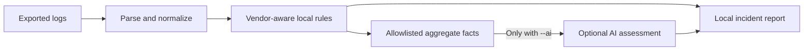

<p align="center">
  
</p>

# Storage Log AI Analyzer

[](https://github.com/darisisuresh/storage-log-ai-analyzer/releases/tag/v0.3.0)
[](https://github.com/darisisuresh/storage-log-ai-analyzer/actions/workflows/ci.yml)
[](pyproject.toml)
[](LICENSE)
[](pyproject.toml)
[](#security-and-privacy)
[](SECURITY.md)

[Website](https://sureshkumardarisi.com/#tools) · [Operator guide](docs/USAGE.md) · [Report an issue](https://github.com/darisisuresh/storage-log-ai-analyzer/issues) · [Contributing](CONTRIBUTING.md)

**Analyze storage logs locally. Use AI assessment when you choose.**

An open-source, vendor-aware tool for analyzing logs from Pure Storage, Dell EMC, and HPE storage systems. It normalizes different log formats, detects operational and security risks locally, and can optionally ask an AI model for a concise incident assessment.

**How to use the tool:** [Read the user guide](docs/USER_GUIDE.md) · [Download the PDF](docs/Storage_Log_AI_Analyzer_User_Guide_v0.3.0.pdf)

## Updates

### v0.3.0 — P0 fixes from the independent review

- **Correctness:** distinguish active incidents from negative/recovery messages and preserve per-device/resource state.
- **Privacy:** AI receives allowlisted aggregate facts only, with no raw log evidence or identities. Preview the exact request with `--ai-preview`.
- **Scale:** streaming input and temporary SQLite incident state replace whole-file/event-list processing. Includes a reproducible million-event benchmark.
- **Verification:** regression tests for recovery, unrelated devices, sensitive data, and input limits. See [P0 evidence and limitations](docs/P0_REVIEW.md).
- **Package change:** incremental JSON parsing now requires `ijson>=3.6.0,<4`; reinstall after pulling.

[Full release notes](docs/releases/v0.3.0.md) · [Changelog](CHANGELOG.md) · [Current user guide](docs/USER_GUIDE.md)


### v0.2.0 — Dependency refresh and reliability fixes

- **Updated packages:** OpenAI SDK 3.42.1+, Setuptools 84.2.1+, Ruff 0.17.3, and Build 1.6.1.
- **More reliable input handling:** fixed forced-vendor detection, JSON/JSONL edge cases, empty input, and file-access errors.
- **Safer optional AI behavior:** bounded requests, disabled response storage, and errors that do not echo provider payloads.
- **New user guide:** [installation-to-report walkthrough](docs/USER_GUIDE.md), with a [downloadable PDF](docs/Storage_Log_AI_Analyzer_User_Guide_v0.3.0.pdf).
- **Version reporting:** run `storage-log-analyzer --version`.
- **Verification:** regression tests, an SDK test with mocked transport, and CI for Python 3.10, 3.12, and 3.14 with and without AI extras.

[Full changelog](CHANGELOG.md) · [Release notes](docs/releases/v0.2.0.md) · [GitHub release](https://github.com/darisisuresh/storage-log-ai-analyzer/releases/tag/v0.2.0)

To update an existing checkout, run `git pull` and `python -m pip install --upgrade -e .`; add `.[ai]` if you use optional AI assessment. See the release notes for SDK compatibility details.

## Navigate

[Updates](#updates) · [Overview](#about) · [Features](#what-it-does) · [Packages](#packages) · [Quick start](#quick-start) · [Demo](#see-it-in-action) · [Vendors](#supported-inputs) · [Commands](#cli) · [Privacy](#security-and-privacy) · [Contributing](#contributing) · [Citation](#citation)

## About

Created by [Suresh Kumar Darisi](https://sureshkumardarisi.com/), Storage Log AI Analyzer helps storage administrators and infrastructure engineers review exported logs, identify operational and security risks, and produce incident reports. It is a Python command-line tool with vendor-aware parsing and local detection rules.

The [project website](https://sureshkumardarisi.com/#tools) introduces the tool and links to its source. Run the analyzer locally using the instructions below.

## What it does

- Parses text, syslog, CSV, JSON, and JSON Lines files
- Recognizes common Pure Storage, Dell EMC, and HPE terminology
- Normalizes events into one consistent schema
- Detects failed disks, path failures, capacity pressure, controller issues, replication failures, authentication attacks, and ransomware-like activity
- Redacts IP addresses, email addresses, serial numbers, and long identifiers before optional AI analysis
- Produces terminal, JSON, or Markdown reports
- Runs offline unless `--ai` is explicitly enabled; raw evidence is excluded from AI requests

> This project is an operational aid, not a replacement for vendor support or an enterprise SIEM. Validate critical findings against the original logs.

## Packages

Requires **Python 3.10 or newer**. Dependencies are declared in [pyproject.toml](pyproject.toml) and installed automatically by pip.

| Package | Version requirement | Used for | Install group |
|---|---|---|---|
| `storage-log-ai-analyzer` | `0.3.0` (alpha prerelease) | The command-line analyzer | Main package |
| `ijson` | `>=3.6.0,<4` | Streaming JSON parsing | Required |
| `openai` | `>=3.42.1,<4` | Optional AI assessment | `ai` |
| `ruff` | `==0.17.3` | Code checks | `dev` |
| `build` | `==1.6.1` | Wheel and source-distribution builds | `dev` |
| `setuptools` | `>=84.2.1,<85` | Python package build backend | Build-time |

SQLite is supplied by Python's standard library; no separate SQLite server or pip package is required. The AI SDK is optional, and ordinary analysis runs offline after installation.

### Install from a source checkout

Run these commands from the repository directory inside your virtual environment:

```bash
# Local analysis; installs the required dependencies.
python -m pip install -e .

# Optional AI support.
python -m pip install -e '.[ai]'

# Development and package-build tools.
python -m pip install -e '.[dev]'

# All extras.
python -m pip install -e '.[ai,dev]'
```

### Download v0.3.0 packages

- [Python wheel (.whl)](https://github.com/darisisuresh/storage-log-ai-analyzer/releases/download/v0.3.0/storage_log_ai_analyzer-0.3.0-py3-none-any.whl)
- [Source distribution (.tar.gz)](https://github.com/darisisuresh/storage-log-ai-analyzer/releases/download/v0.3.0/storage_log_ai_analyzer-0.3.0.tar.gz)
- [All release files and notes](https://github.com/darisisuresh/storage-log-ai-analyzer/releases/tag/v0.3.0)

After downloading the wheel, install it from its download directory:

```bash
python -m pip install ./storage_log_ai_analyzer-0.3.0-py3-none-any.whl
storage-log-analyzer --version
python -m pip check
```

For AI support with the downloaded wheel, use `python -m pip install './storage_log_ai_analyzer-0.3.0-py3-none-any.whl[ai]'`.

Packages are distributed through GitHub Releases. They have not been published to PyPI or the GitHub Packages registry. See the [user guide](docs/USER_GUIDE.md) for platform-specific setup and the [changelog](CHANGELOG.md) for package updates.

## Quick start

Requires Python 3.10 or newer.

```bash
git clone https://github.com/darisisuresh/storage-log-ai-analyzer.git
cd storage-log-ai-analyzer
python -m venv .venv
source .venv/bin/activate
pip install -e .
storage-log-analyzer analyze samples/mixed-storage.log
```

On Windows PowerShell, activate the environment with `.venv\Scripts\Activate.ps1` instead of `source .venv/bin/activate`.

The sample contains risk events. By default, analysis returns exit code `2` when high or critical risk is found; this indicates a detected risk rather than an installation failure. Add `--fail-on never` when you want a report without a risk-based exit code.

Generate a Markdown incident report:

```bash
storage-log-analyzer analyze samples/mixed-storage.log --format markdown --output report.md
```

Enable optional OpenAI analysis:

```bash
pip install -e '.[ai]'
export OPENAI_API_KEY='your-key'
storage-log-analyzer analyze samples/mixed-storage.log --ai
```

Ordinary analysis runs offline. `--ai` sends allowlisted aggregate rule facts only; raw evidence, filenames, device identifiers, and arbitrary log fields are excluded. Use `--ai-preview` to inspect the exact request without contacting a provider.

## See it in action

The screenshot below is generated from actual CLI output on the bundled [synthetic sample](samples/mixed-storage.log), with five events across three vendor families. It illustrates rule matches, not a measured detection-accuracy benchmark.

```bash
storage-log-analyzer analyze samples/mixed-storage.log --fail-on never
```


[View the complete plain-text output](docs/demo/sample-output.txt).

## Supported inputs

| Vendor | Initial coverage |
|---|---|
| Pure Storage | FlashArray-style alerts, volume/capacity, controller, replication, drive and authentication messages |
| Dell EMC | PowerStore, Unity, PowerMax/VMAX, Isilon/PowerScale, Data Domain and generic EMC messages |
| HPE | Alletra, Nimble, Primera, 3PAR, MSA and generic HPE storage messages |

Vendor formats vary by product and software release. Unknown lines are still retained and analyzed through common storage patterns. Add product-specific fixtures and parsing rules in `src/storage_log_analyzer/vendors.py`.

## CLI

```text
storage-log-analyzer analyze PATH [--vendor auto|pure|emc|hpe] [--ai]
storage-log-analyzer summary PATH [--format text|json]
storage-log-analyzer validate PATH [--strict]
storage-log-analyzer redact FILE --output SANITIZED_FILE
storage-log-analyzer rules [--format text|json]
storage-log-analyzer vendors
```

The input path can be one file or a directory. Directory scanning includes `.log`, `.txt`, `.json`, `.jsonl`, and `.csv` files.

See the complete [operator procedure](docs/USAGE.md) for log collection, validation, offline analysis, safe redaction, AI setup, automation exit codes, and incident triage.

## Architecture



Local reports may contain original event evidence and file paths. Review and sanitize reports before sharing. The optional AI request excludes raw evidence entirely; local outputs are not automatically sanitized.

Normalized event fields include timestamp, vendor, product, severity, component, message, source file, and source line. Each finding includes severity, category, evidence, and recommended actions.

## Documentation

| Resource | What it covers |
|---|---|
| [User guide](docs/USER_GUIDE.md) | Installation, commands, examples, privacy, automation, and troubleshooting |
| [PDF user guide](docs/Storage_Log_AI_Analyzer_User_Guide_v0.3.0.pdf) | Downloadable usage document for v0.3.0 |
| [Project website](https://sureshkumardarisi.com/#tools) | Tool overview and author profile |
| [Operator procedure](docs/USAGE.md) | Installation, log collection, validation, redaction, AI setup, and automation |
| [Contributing guide](CONTRIBUTING.md) | Vendor rules, sanitized fixtures, and contributions |
| [Issue tracker](https://github.com/darisisuresh/storage-log-ai-analyzer/issues) | Bug reports and feature requests |

## Development

```bash
python -m unittest discover -s tests -v
python -m storage_log_analyzer analyze samples/mixed-storage.log
```

See [CONTRIBUTING.md](CONTRIBUTING.md) for adding vendor rules and sanitized fixtures.

## Security and privacy

- Treat storage logs as sensitive operational data.
- Use offline analysis for regulated or isolated environments.
- Review a sanitized copy with the `redact` command before enabling external AI in production. Redaction cannot guarantee removal of customer-specific free-form names.
- Never commit real credentials, customer names, IP addresses, serial numbers, or unredacted support bundles.
- Pin and review dependencies before production deployment.

## Limits and incident state

Reports retain resolved history but exclude it from current risk. Correlation uses explicit device/resource identity when available and source-file scope otherwise. Supply chronological logs: global cross-file temporal sorting and vendor-specific recovery semantics remain future work. Evidence/device samples are limited to five per rule/state group; counts remain exact. See [limits and benchmark evidence](docs/P0_REVIEW.md).

## Limitations

- Vendor coverage uses terminology and rules from supported text exports; it is not a native support-bundle parser or certified vendor integration.
- Rule matches require operator review. Missing a known pattern does not prove a system is healthy or secure.
- Redaction is heuristic and may retain free-form sensitive names. Review the data before sharing or enabling AI.
- This release is a CLI. A hosted log-upload service, streaming collector, and web dashboard are not included.

## Contributing

See [CONTRIBUTING.md](CONTRIBUTING.md) for the development workflow. Use the [bug report](https://github.com/darisisuresh/storage-log-ai-analyzer/issues/new?template=bug_report.yml) or [feature request](https://github.com/darisisuresh/storage-log-ai-analyzer/issues/new?template=feature_request.yml) forms. Attach only synthetic or carefully sanitized examples.

Read the [Code of Conduct](CODE_OF_CONDUCT.md) and [Security Policy](SECURITY.md). Report sensitive vulnerabilities privately using the contact listed in the security policy.

## Citation

If you use this software in research, use GitHub's **Cite this repository** entry or [CITATION.cff](CITATION.cff). Cite the exact commit or version used for your work. No DOI has been assigned by this repository.

## Roadmap

- Native support-bundle extractors for individual array families
- Streaming syslog ingestion and alert webhooks
- Web dashboard and incident history
- Pluggable local-model providers
- MITRE ATT&CK mapping and SIEM export

## License

MIT License. See [LICENSE](LICENSE).
