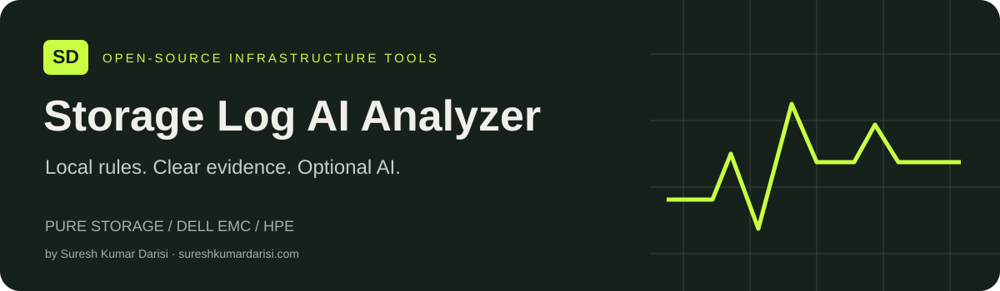
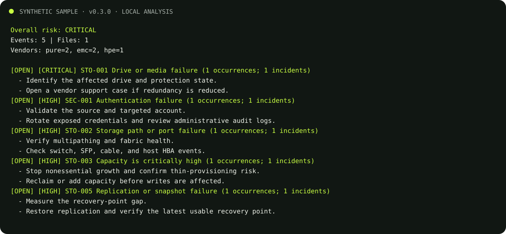
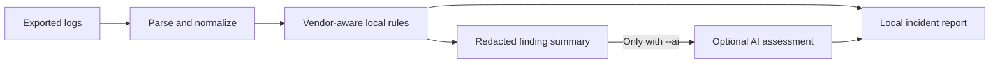

<p align="center">
  
</p>

# Storage Log AI Analyzer

[](https://github.com/darisisuresh/storage-log-ai-analyzer/actions/workflows/ci.yml)
[](pyproject.toml)
[](LICENSE)
[](pyproject.toml)
[](#security-and-privacy)
[](SECURITY.md)

[Website](https://sureshkumardarisi.com/#tools) · [Operator guide](docs/USAGE.md) · [Report an issue](https://github.com/darisisuresh/storage-log-ai-analyzer/issues) · [Contributing](CONTRIBUTING.md)

**Analyze storage logs locally. Use AI assessment when you choose.**

An open-source, vendor-aware tool for analyzing logs from Pure Storage, Dell EMC, and HPE storage systems. It normalizes different log formats, detects operational and security risks locally, and can optionally ask an AI model for a concise incident assessment.

## Navigate

[Overview](#about) · [Features](#what-it-does) · [Quick start](#quick-start) · [Demo](#see-it-in-action) · [Vendors](#supported-inputs) · [Commands](#cli) · [Privacy](#security-and-privacy) · [Contributing](#contributing) · [Citation](#citation)

## About

Created by [Suresh Kumar Darisi](https://sureshkumardarisi.com/), Storage Log AI Analyzer helps storage administrators and infrastructure engineers review exported logs, identify operational and security risks, and produce incident reports. It is a Python command-line tool with vendor-aware parsing and local detection rules.

The [project website](https://sureshkumardarisi.com/#tools) introduces the tool and links to its source. Run the analyzer locally using the instructions below.

## What it does

- Parses text, syslog, CSV, JSON, and JSON Lines files
- Recognizes common Pure Storage, Dell EMC, and HPE terminology
- Normalizes events into one consistent schema
- Detects failed disks, path failures, capacity pressure, controller issues, replication failures, authentication attacks, and ransomware-like activity
- Redacts IP addresses, email addresses, serial numbers, and long identifiers before optional AI analysis
- Produces terminal, JSON, or Markdown reports
- Runs offline unless `--ai` is explicitly enabled

> This project is an operational aid, not a replacement for vendor support or an enterprise SIEM. Validate critical findings against the original logs.

## Quick start

Requires Python 3.10 or newer.

```bash
git clone https://github.com/darisisuresh/storage-log-ai-analyzer.git
cd storage-log-ai-analyzer
python -m venv .venv
source .venv/bin/activate
pip install -e .
storage-log-analyzer analyze samples/mixed-storage.log
```

On Windows PowerShell, activate the environment with `.venv\Scripts\Activate.ps1` instead of `source .venv/bin/activate`.

The sample contains risk events. By default, analysis returns exit code `2` when high or critical risk is found; this indicates a detected risk rather than an installation failure. Add `--fail-on never` when you want a report without a risk-based exit code.

Generate a Markdown incident report:

```bash
storage-log-analyzer analyze samples/mixed-storage.log --format markdown --output report.md
```

Enable optional OpenAI analysis:

```bash
pip install -e '.[ai]'
export OPENAI_API_KEY='your-key'
storage-log-analyzer analyze samples/mixed-storage.log --ai
```

No log data is sent externally unless `--ai` is used. The AI receives a redacted, bounded summary rather than the entire raw file.

## See it in action

The screenshot below is generated from actual CLI output on the bundled [synthetic sample](samples/mixed-storage.log), with five events across three vendor families. It illustrates rule matches, not a measured detection-accuracy benchmark.

```bash
storage-log-analyzer analyze samples/mixed-storage.log --fail-on never
```



[View the complete plain-text output](docs/demo/sample-output.txt).

## Supported inputs

| Vendor | Initial coverage |
|---|---|
| Pure Storage | FlashArray-style alerts, volume/capacity, controller, replication, drive and authentication messages |
| Dell EMC | PowerStore, Unity, PowerMax/VMAX, Isilon/PowerScale, Data Domain and generic EMC messages |
| HPE | Alletra, Nimble, Primera, 3PAR, MSA and generic HPE storage messages |

Vendor formats vary by product and software release. Unknown lines are still retained and analyzed through common storage patterns. Add product-specific fixtures and parsing rules in `src/storage_log_analyzer/vendors.py`.

## CLI

```text
storage-log-analyzer analyze PATH [--vendor auto|pure|emc|hpe] [--ai]
storage-log-analyzer summary PATH [--format text|json]
storage-log-analyzer validate PATH [--strict]
storage-log-analyzer redact FILE --output SANITIZED_FILE
storage-log-analyzer rules [--format text|json]
storage-log-analyzer vendors
```

The input path can be one file or a directory. Directory scanning includes `.log`, `.txt`, `.json`, `.jsonl`, and `.csv` files.

See the complete [operator procedure](docs/USAGE.md) for log collection, validation, offline analysis, safe redaction, AI setup, automation exit codes, and incident triage.

## Architecture



Local reports may contain original event evidence and file paths. Review and sanitize reports before sharing. Redaction is applied before the optional AI request; it does not automatically sanitize every local output.

Normalized event fields include timestamp, vendor, product, severity, component, message, source file, and source line. Each finding includes severity, category, evidence, and recommended actions.

## Documentation

| Resource | What it covers |
|---|---|
| [Project website](https://sureshkumardarisi.com/#tools) | Tool overview and author profile |
| [Operator procedure](docs/USAGE.md) | Installation, log collection, validation, redaction, AI setup, and automation |
| [Contributing guide](CONTRIBUTING.md) | Vendor rules, sanitized fixtures, and contributions |
| [Issue tracker](https://github.com/darisisuresh/storage-log-ai-analyzer/issues) | Bug reports and feature requests |

## Development

```bash
python -m unittest discover -s tests -v
python -m storage_log_analyzer analyze samples/mixed-storage.log
```

See [CONTRIBUTING.md](CONTRIBUTING.md) for adding vendor rules and sanitized fixtures.

## Security and privacy

- Treat storage logs as sensitive operational data.
- Use offline analysis for regulated or isolated environments.
- Review a sanitized copy with the `redact` command before enabling external AI in production. Redaction cannot guarantee removal of customer-specific free-form names.
- Never commit real credentials, customer names, IP addresses, serial numbers, or unredacted support bundles.
- Pin and review dependencies before production deployment.

## Limitations

- Vendor coverage uses terminology and rules from supported text exports; it is not a native support-bundle parser or certified vendor integration.
- Rule matches require operator review. Missing a known pattern does not prove a system is healthy or secure.
- Redaction is heuristic and may retain free-form sensitive names. Review the data before sharing or enabling AI.
- This release is a CLI. A hosted log-upload service, streaming collector, and web dashboard are not included.

## Contributing

See [CONTRIBUTING.md](CONTRIBUTING.md) for the development workflow. Use the [bug report](https://github.com/darisisuresh/storage-log-ai-analyzer/issues/new?template=bug_report.yml) or [feature request](https://github.com/darisisuresh/storage-log-ai-analyzer/issues/new?template=feature_request.yml) forms. Attach only synthetic or carefully sanitized examples.

Read the [Code of Conduct](CODE_OF_CONDUCT.md) and [Security Policy](SECURITY.md). Report sensitive vulnerabilities privately using the contact listed in the security policy.

## Citation

If you use this software in research, use GitHub's **Cite this repository** entry or [CITATION.cff](CITATION.cff). Cite the exact commit or version used for your work. No DOI has been assigned by this repository.

## Roadmap

- Native support-bundle extractors for individual array families
- Streaming syslog ingestion and alert webhooks
- Web dashboard and incident history
- Pluggable local-model providers
- MITRE ATT&CK mapping and SIEM export

## License

MIT License. See [LICENSE](LICENSE).
